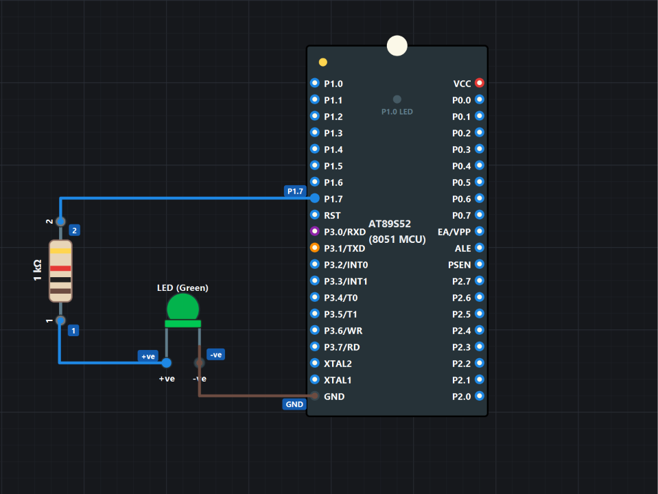

# CAT-2 TASK-2B

| **Field** | **Details** |
|---|---|
| **EXP** | Continuous Lab Evaluation-2 (`CAT2` / `TASK2B`) |
| **TASK NO** | **Task 2B — Bare-Metal LED Blink & Custom Delay Library** |
| **DATE** | 24/07/2026 |
| **NAME OF EXP** | Bare-Metal LED Blink |

## HARDWARE SETUP / PLATFORM

- **Development Board:** 8051 Development Board
- **Microcontroller IC & Model:** Atmel `AT89S52` (8-bit 8051 Architecture)
- **Toolchain / IDE:** Keil µVision
- **Firmware Approach:** Bare-metal Embedded C using direct SFR bit-addressable access (`<reg51.h>`).
- **Peripherals:** Green LED with 1 kΩ current-limiting resistor.
- **Pin Mapping:**
  - `P1.7` — LED output (active-low).

### Hardware Schematic

## Core Logic / Pseudocode / Code Base

### Working Principle
- LED is controlled through the bit-addressable declaration `sbit ledpin = P1^7`.
- Active-low operation: `ledpin = 0` turns the LED ON and `ledpin = 1` turns it OFF.
- A custom software delay function using nested `for` loops provides the delay between LED transitions.

### Pseudocode
- Initialize the LED control pin.
- Continuously:
  - Set LED OFF and call `delay()`.
  - Set LED ON and call `delay()`.
- Repeat indefinitely.

### Code Base

Project files in `8051/CAT2/TASK2B/`:

- `blinker.uvproj` — Keil µVision project configuration.
- `STARTUP.A51` — 8051 startup assembly file.
- `main.c` — Controls LED blinking through `P1.7`.
- `delay.h` — Declares the delay function.
- `delay.c` — Implements the delay using nested loops (400 × 400 iterations).

## INFERENCE

- Implemented LED blinking using direct GPIO control on the AT89S52.
- Demonstrated active-low LED operation through `P1.7`.
- Developed a reusable software delay function using modular Embedded C programming.
