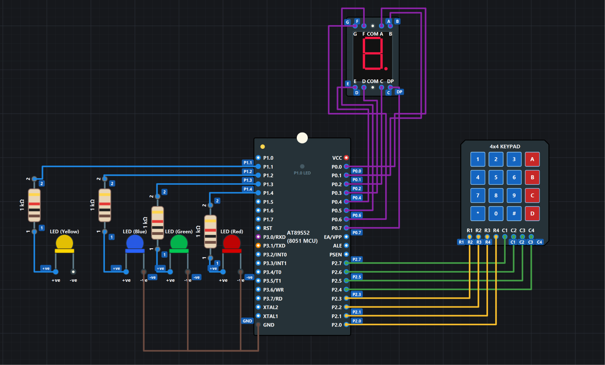

# CAT-4 TASK-4A

| **Field** | **Details** |
|---|---|
| **EXP** | Continuous Lab Evaluation-4 (`CAT4` / `TASK4A`) |
| **TASK NO** | **Task 4A — Matrix Keypad, LEDs & Seven-Segment HMI** |
| **DATE** | 07/08/2026 |
| **NAME OF EXP** | Human-Machine Interface using Matrix Keypad, LEDs, and Seven-Segment Display |

## HARDWARE SETUP / PLATFORM

- **Development Board:** 8051 Development Board
- **Microcontroller IC & Model:** Atmel `AT89S52` (8-bit 8051 Architecture)
- **Toolchain / IDE:** Keil µVision
- **Firmware Approach:** Bare-metal Embedded C using direct SFR bit-addressable access (`<reg51.h>`).
- **Peripherals:** 4×4 Matrix Keypad, four LEDs with 1 kΩ resistors, Common Cathode Seven-Segment Display.
- **Pin Mapping:**
  - `P2.0–P2.3` — Keypad rows.
  - `P2.4–P2.7` — Keypad columns.
  - `P1.1–P1.4` — Four LED outputs.
  - `P0` — Seven-segment display interface.

### Hardware Schematic

## Core Logic / Pseudocode / Code Base

### Working Principle
- The 4×4 keypad is scanned row-by-row to detect key presses, with software debouncing.
- The detected key value is displayed on the seven-segment display using a common-cathode lookup table.
- LED operations are selected based on the pressed key, including individual LED control, running pattern, alternating pattern, binary counter and simultaneous blinking.
- Separate functions handle keypad scanning, display output and LED control.

### Pseudocode
- Initialize keypad, LED and seven-segment pin configurations.
- Continuously:
  - Scan the keypad for a key press.
  - Identify the pressed key and perform debouncing.
  - Display the corresponding digit on the seven-segment display.
  - Execute the associated LED operation.
- Repeat indefinitely.

### Code Base

- `main.c` — Main program loop coordinating keypad scanning, display and LED control.
- `pins.h` — Defines keypad row/column pins, LED pins and seven-segment port.
- `functions.c` — Implements keypad scanning, seven-segment digit decoding, LED control and LED patterns.
- `functions.h` — Contains function declarations and the shared key variable.
- `delay.c` — Implements software delay functions using nested loops.
- `delay.h` — Declares delay function prototypes.

## INFERENCE

- Implemented a keypad-based human-machine interface using the AT89S52 microcontroller.
- Demonstrated keypad scanning, software debouncing and seven-segment digit display.
- Implemented multiple LED operations controlled through keypad input.
- Demonstrated modular Embedded C programming using separate header and source files.
