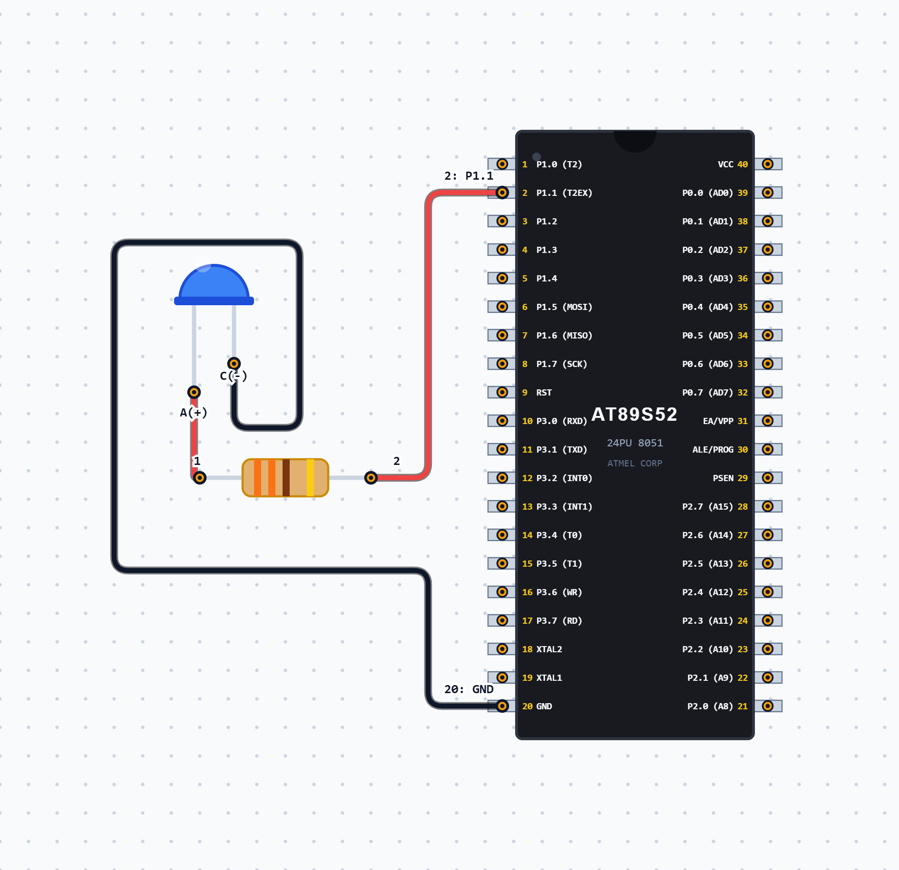

# CAT-5 TASK-5A

| **Field** | **Details** |
|---|---|
| **EXP** | Continuous Lab Evaluation-5 (`CAT5` / `TASK5A`) |
| **TASK NO** | **Task 5A — Hardware Timer-Based LED Blinking (`Timer 0` Polling)** |
| **DATE** | 14/08/2026 |
| **NAME OF EXP** | Hardware Timer and Interrupt-Based Timing for LED Fading, Pulse Generation, and Stepper Motor Control |

## HARDWARE SETUP / PLATFORM

- **Development Board:** 8051 Development Board
- **Microcontroller IC & Model:** Atmel `AT89S52` (8-bit 8051 Architecture)
- **Toolchain / IDE:** Keil µVision
- **Firmware Approach:** Bare-metal Embedded C using direct SFR and Timer 0 register access (`<reg51.h>`).
- **Peripherals:** Blue LED with 1 kΩ current-limiting resistor.
- **Pin Mapping:**
  - `P1.1` — LED output.

### Hardware Schematic

  
## Core Logic / Pseudocode / Code Base

### Working Principle
- Timer 0 is configured in **Mode 1 (16-bit timer mode)** using `TMOD = 0x01`.
- Timer registers are loaded with `TH0 = 0xFA` and `TL0 = 0x9A`.
- Timer overflow is monitored through the `TF0` flag.
- After 533 overflows, the LED connected to `P1.1` is toggled and the counter is reset.
- Timer registers are reloaded after every overflow to maintain periodic timing.

### Pseudocode
- Initialize the LED output and configure Timer 0.
- Start Timer 0.
- Continuously monitor the overflow flag.
- On each overflow:
  - Clear `TF0` and increment the overflow counter.
  - Reload `TH0` and `TL0`.
  - Toggle the LED after 533 overflows.
  - Reset the counter.
- Repeat continuously.

### Code Base

- `main.c` — Initializes the LED and calls the Timer 0 initialization function.
- `functions.c` — Configures Timer 0, monitors overflow and toggles the LED after the required number of overflows.
- `functions.h` — Declares the `timer0_init()` function.
- `pins.h` — Defines the LED output pin (`P1.1`).

## INFERENCE

- Implemented timer-based LED toggling using Timer 0 in 16-bit mode.
- Demonstrated timer register configuration, overflow flag monitoring and software-based overflow counting.
- Achieved periodic LED state changes without using software delay loops.
