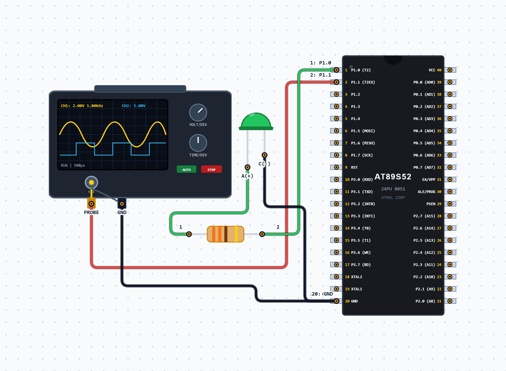

# CAT-5 TASK-5B.3

| **Field** | **Details** |
|---|---|
| **EXP** | Continuous Lab Evaluation-5 (`CAT5` / `TASK5B.3`) |
| **TASK NO** | **Task 5B.3 — Timer 1 Interrupt-Driven Waveform & PWM Generation** |
| **DATE** | 14/08/2026 |
| **NAME OF EXP** | Hardware Timer and Interrupt-Based Timing for LED Fading, Pulse Generation, and Stepper Motor Control |

## HARDWARE SETUP / PLATFORM

- **Development Board:** 8051 Development Board
- **Microcontroller IC & Model:** Atmel `AT89S52` (8-bit 8051 Architecture)
- **Toolchain / IDE:** Keil µVision
- **Firmware Approach:** Bare-metal Embedded C using Timer 1 interrupts and direct SFR access (`<reg51.h>`).
- **Peripherals:** Green LED with current-limiting resistor; oscilloscope for waveform monitoring.
- **Pin Mapping:**
  - `P1.0` — LED output for variable duty-cycle control.
  - `P1.1` — Waveform output for pulse train and burst signal.
  - `GND` — Common ground reference.

### Hardware Schematic

## Core Logic / Pseudocode / Code Base

### Working Principle
- Timer 1 is configured in 16-bit mode and generates periodic interrupts.
- **Variable Duty-Cycle Wave:** PWM duty cycle gradually increases from 0% to 100% and decreases back to 0%, controlling LED brightness.
- **Pulse Train:** Generates a repeating sequence of HIGH and LOW output states.
- **Burst Signal:** Generates alternating pulses followed by a LOW interval, repeating continuously.
- Output timing and signal transitions are handled inside the Timer 1 interrupt service routines.

### Pseudocode
- Configure Timer 1 and initialize the output pins.
- Enable Timer 1 interrupts and global interrupts.
- Start Timer 1.
- On each timer interrupt:
  - Reload timer registers.
  - Update the corresponding signal counter.
  - Generate the selected waveform or adjust the PWM duty cycle.
- Repeat continuously.

### Code Base

- `main1.c` — Generates a pulse train using Timer 1 interrupts.
- `main2.c` — Generates a burst signal with alternating pulses and LOW intervals.
- `main3.c` — Implements variable duty-cycle PWM for gradual LED fading.

## INFERENCE

- Implemented timer-interrupt-based waveform generation using the AT89S52 microcontroller.
- Demonstrated pulse train and burst signal generation through GPIO output control.
- Implemented variable duty-cycle PWM for gradual LED brightness variation.
- Demonstrated interrupt-driven timing without software delay loops.
