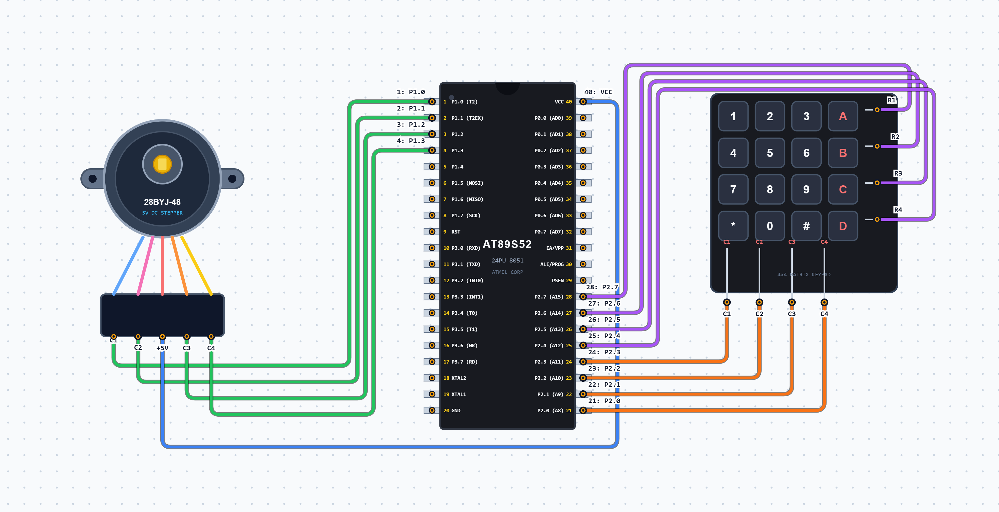

# CAT-5 TASK-5C

| **Field** | **Details** |
|---|---|
| **EXP** | Continuous Lab Evaluation-5 (`CAT5` / `TASK5C`) |
| **TASK NO** | **Task 5C — Interrupt-Driven Stepper Motor Speed Controller** |
| **DATE** | 14/08/2026 |
| **NAME OF EXP** | Hardware Timer and Interrupt-Based Timing for LED Fading, Pulse Generation, and Stepper Motor Control |

## HARDWARE SETUP / PLATFORM

- **Development Board:** 8051 Development Board
- **Microcontroller IC & Model:** Atmel `AT89S52` (8-bit 8051 Architecture)
- **Toolchain / IDE:** Keil µVision
- **Firmware Approach:** Bare-metal Embedded C using Timer 0 interrupts and direct SFR access (`<reg51.h>`).
- **Peripherals:** 28BYJ-48 Stepper Motor with driver module; 4×4 Matrix Keypad.
- **Pin Mapping:**
  - `P1.0–P1.3` — Stepper motor control outputs.
  - `P2.4–P2.7` — Keypad rows.
  - `P2.0–P2.3` — Keypad columns.

### Hardware Schematic

## Core Logic / Pseudocode / Code Base

### Working Principle
- Timer 0 is configured in 16-bit mode to generate periodic interrupts.
- The motor is driven using a four-step sequence (`1000`, `0100`, `0010`, `0001`).
- A 4×4 keypad selects motor speed through keys `1`, `2` and `3`.
- The `setspeed()` function updates the speed parameter, while the Timer 0 interrupt controls the stepping interval.
- Motor stepping is handled through the `motor()` function.

### Pseudocode
- Initialize motor outputs and configure Timer 0.
- Enable Timer 0 interrupts.
- Continuously scan the keypad for speed selection.
- On a valid key press, update the motor speed.
- On each timer interrupt:
  - Reload Timer 0.
  - Update the step counter.
  - Generate the next motor sequence when the selected interval is reached.
- Repeat continuously.

### Code Base

- `main(5).c` — Implements keypad scanning, speed selection, Timer 0 initialization, interrupt handling and sequential stepper motor control.

## INFERENCE

- Implemented interrupt-driven stepper motor control using the AT89S52.
- Demonstrated sequential motor excitation using a four-step sequence.
- Implemented keypad-based speed selection.
- Demonstrated timer-based motor stepping without software delay loops.
