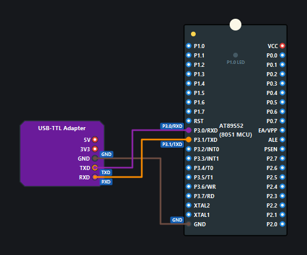

# CAT-6 TASK-6A

| **Field** | **Details** |
|---|---|
| **EXP** | Continuous Lab Evaluation-6 (`CAT6` / `TASK6A`) |
| **TASK NO** | **Task 6A — UART Initialization & Character Transmission** |
| **DATE** | 21/08/2026 |
| **NAME OF EXP** | UART Driver and Serial Debugging |

## HARDWARE SETUP / PLATFORM

- **Development Board:** 8051 Development Board
- **Microcontroller IC & Model:** Atmel `AT89S52` (8-bit 8051 Architecture)
- **Toolchain / IDE:** Keil µVision
- **Firmware Approach:** Bare-metal Embedded C using UART and Timer 1 SFR configuration (`<reg51.h>`).
- **Peripherals:** USB-to-TTL Serial Adapter, PC with PuTTY terminal.
- **Pin Mapping:**
  - `P3.1 (TXD)` — UART transmit.
  - `P3.0 (RXD)` — UART receive.
  - `GND` — Common ground with USB-to-TTL adapter.

### Hardware Schematic

## Core Logic / Pseudocode / Code Base

### Working Principle
- UART is configured in Mode 1 (8-bit asynchronous communication) using `SCON = 0x50`.
- Timer 1 is configured in Mode 2 (8-bit auto-reload) using `TMOD = 0x20` to generate the baud rate.
- `TH1 = 0xFD` configures the timer for 9600 baud with an 11.0592 MHz crystal.
- The character `A` is loaded into `SBUF` for transmission.
- The `TI` flag is monitored to detect transmission completion and cleared before the next transmission.

### Pseudocode
- Configure Timer 1 and UART registers.
- Start Timer 1 and initialize serial communication.
- Continuously:
  - Load character `A` into `SBUF`.
  - Wait until the `TI` transmission flag is set.
  - Clear `TI`.
- Repeat indefinitely.

### Code Base

- `main.c` — Configures UART and Timer 1, then continuously transmits the character `A` through the serial interface.

## INFERENCE

- Successfully configured UART communication on the AT89S52 at 9600 baud.
- Demonstrated serial character transmission using the `SBUF` register and `TI` flag.
- Verified the UART interface through a USB-to-TTL adapter and PC terminal.
