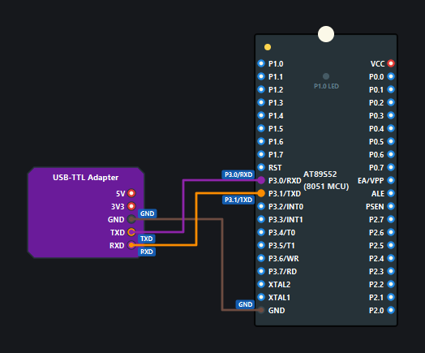

# CAT-6 TASK-6B

| **Field** | **Details** |
|---|---|
| **EXP** | Continuous Lab Evaluation-6 (`CAT6` / `TASK6B`) |
| **TASK NO** | **Task 6B — Full-Duplex UART Echo** |
| **DATE** | 21/08/2026 |
| **NAME OF EXP** | UART Driver and Serial Debugging |

## HARDWARE SETUP / PLATFORM

- **Development Board:** 8051 Development Board
- **Microcontroller IC & Model:** Atmel `AT89S52` (8-bit 8051 Architecture)
- **Toolchain / IDE:** Keil µVision
- **Firmware Approach:** Bare-metal Embedded C using UART and Timer 1 SFR configuration (`<reg51.h>`).
- **Peripherals:** USB-to-TTL Serial Adapter, PC with PuTTY terminal.
- **Pin Mapping:**
  - `P3.0 (RXD)` — UART receive.
  - `P3.1 (TXD)` — UART transmit.
  - `GND` — Common ground with USB-to-TTL adapter.

### Hardware Schematic

## Core Logic / Pseudocode / Code Base

### Working Principle
- UART is configured in Mode 1 using `SCON = 0x50` for 8-bit asynchronous communication.
- Timer 1 operates in Mode 2 (8-bit auto-reload) to generate the baud rate.
- The program waits for the `RI` flag to detect incoming data.
- The received character is read from `SBUF`, stored in a variable and transmitted back through `SBUF`.
- The `RI` and `TI` flags are cleared after reception and transmission respectively.

### Pseudocode
- Configure UART and Timer 1.
- Start Timer 1.
- Continuously:
  - Wait for the `RI` flag.
  - Read the received character from `SBUF`.
  - Clear `RI`.
  - Transmit the same character through `SBUF`.
  - Wait for `TI` and clear it.
- Repeat indefinitely.

### Code Base

- `main.c` — Configures UART communication, receives characters from the PC and echoes them back using the `SBUF`, `RI` and `TI` registers.

## INFERENCE

- Implemented UART-based bidirectional character communication between the AT89S52 and a PC.
- Demonstrated serial data reception and retransmission using UART status flags.
- Verified character echo functionality through a USB-to-TTL interface and PuTTY terminal.
