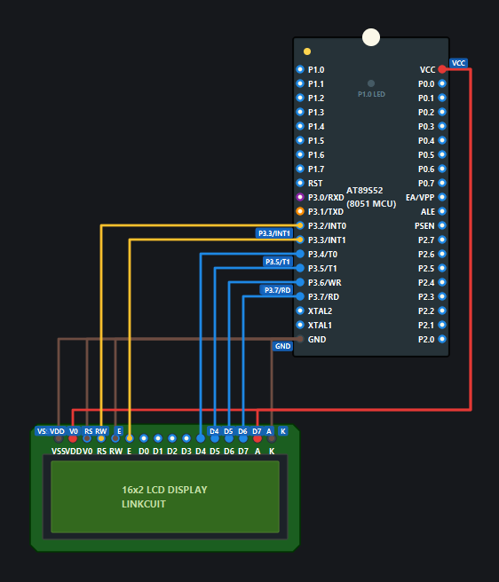

# CAT-7 TASK-7B

| **Field** | **Details** |
|---|---|
| **EXP** | Continuous Lab Evaluation-7 (`CAT7` / `TASK7B`) |
| **TASK NO** | **Task 7B — Cursor Positioning & Dynamic Numeric Output** |
| **DATE** | 28/08/2026 |
| **NAME OF EXP** | 16×2 LCD Driver Development and Dynamic Display Control |

## HARDWARE SETUP / PLATFORM

- **Development Board:** 8051 Development Board
- **Microcontroller IC & Model:** Atmel `AT89S52` (8-bit 8051 Architecture)
- **Toolchain / IDE:** Keil µVision
- **Firmware Approach:** Bare-metal Embedded C using direct GPIO control (`<reg51.h>`).
- **Peripherals:** 16×2 HD44780-compatible LCD.
- **Pin Mapping:**
  - `P3.2` — LCD Register Select (RS).
  - `P3.3` — LCD Enable (E).
  - `P3.4–P3.7` — LCD data lines (D4–D7).
  - `GND` — LCD ground and RW connection.
  - `VCC` — LCD power supply.

### Hardware Schematic

## Core Logic / Pseudocode / Code Base

### Working Principle
- LCD operates in 4-bit, 2-line mode.
- `lcd_init()` initializes the LCD, while `lcd_cmd()` and `lcd_putc()` handle commands and character transmission.
- `lcd_goto()` positions the cursor using row and column values.
- `lcd_puts()` displays strings, while `lcd_print_number()` converts and displays integer values digit by digit.
- The program displays strings and the number `13` at specified LCD positions.

### Pseudocode
- Initialize the LCD in 4-bit mode.
- Display `HI` at row 1, column 1.
- Display `There` at row 2, column 4.
- Position the cursor at row 1, column 9 and display `13`.
- Keep the display running.

### Code Base

- `main.c` — Implements LCD initialization, 4-bit data transmission, cursor positioning, string display and integer-to-character conversion using `lcd_print_number()`.

## INFERENCE

- Successfully interfaced a 16×2 LCD with the AT89S52.
- Demonstrated cursor positioning and string display at specified locations.
- Implemented integer display through digit extraction and character conversion.
- Demonstrated modular LCD control using Embedded C functions.
