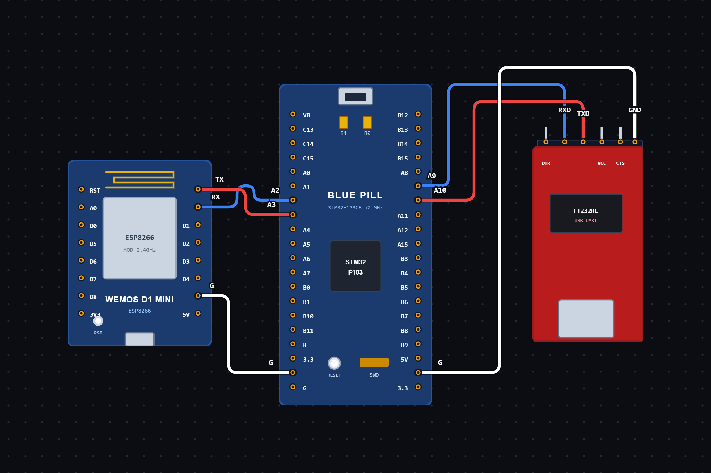

# CAT-10 TASK-10B

| **Field** | **Details** |
|---|---|
| **EXP** | Continuous Lab Evaluation-10 (`CAT10` / `TASK10B`) |
| **TASK NO** | **Task 10B — Explore the ESP8266 AT Command Interface** |
| **DATE** | 09/10/2026 |
| **NAME OF EXP** | STM32–Wemos Wi-Fi Modem Interface Using AT Commands |

## HARDWARE SETUP / PLATFORM

- **Development Board:** STM32 Blue Pill (`STM32F103C8T6`, ARM Cortex-M3, 72 MHz).
- **Toolchain / IDE:** STM32CubeMX + Keil MDK-ARM.
- **Firmware Libraries:** STM32F1xx HAL Drivers, CMSIS.
- **Peripherals:** Wemos D1 Mini (ESP8266), FT232RL USB-to-UART Converter.
- **Pin Mapping:**
  - `PA2` (`USART2_TX`) — Connected to Wemos RX.
  - `PA3` (`USART2_RX`) — Connected to Wemos TX.
  - `PA9` (`USART1_TX`) — Connected to FT232RL RXD.
  - `PA10` (`USART1_RX`) — Connected to FT232RL TXD.
  - `GND` — Common ground.

### Hardware Schematic

## CORE LOGIC / PSEUDOCODE / CODE BASE

### Working Principle

- Initializes `USART1` and `USART2` at 115200 baud (8-N-1).
- Sends ESP8266 AT commands through `USART2`.
- Executes `AT`, `AT+CWMODE=1` and `AT+CWJAP` to test modem response, configure station mode and connect to the Wi-Fi network.
- Receives ESP8266 responses and forwards them to the PC terminal through `USART1`.

### Pseudocode

- Initialize HAL, system clock, GPIO and both UART peripherals.
- Transmit `AT\r\n` and receive the modem response.
- Transmit `AT+CWMODE=1\r\n` to configure Wi-Fi station mode.
- Transmit `AT+CWJAP` with the Wi-Fi SSID and password.
- Forward received responses to the PC terminal.
- Introduce a delay to allow Wi-Fi connection.

### Code Base

- `SystemClock_Config()` – Configures the 72 MHz system clock.
- `MX_GPIO_Init()` – Initializes GPIO clocks.
- `MX_USART1_UART_Init()` – Configures UART communication with the PC.
- `MX_USART2_UART_Init()` – Configures UART communication with the ESP8266.
- `HAL_UART_Transmit()` – Sends AT commands to the ESP8266.
- `HAL_UART_Receive()` – Captures modem responses.
- `memset()` – Clears the receive buffer between commands.

## INFERENCE

- Demonstrated ESP8266 modem configuration using AT commands through STM32 UART communication.
- Implemented Wi-Fi station mode configuration and network connection using `AT+CWMODE` and `AT+CWJAP`.
- Forwarded modem responses to the PC terminal for monitoring.
