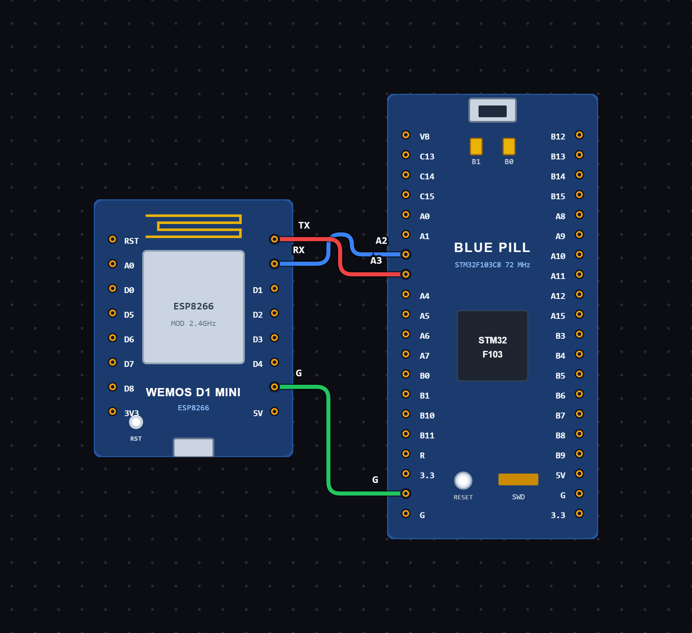

# CAT-11 TASK-11A

| **Field** | **Details** |
|---|---|
| **EXP** | Continuous Lab Evaluation-11 (`CAT11` / `TASK11A`) |
| **TASK NO** | **Task 11A — TCP Server Setup & IP Retrieval** |
| **DATE** | 22/10/2026 |
| **NAME OF EXP** | HTTP Server - STM32–Wemos Wi-Fi Modem Using AT Commands |

## HARDWARE SETUP / PLATFORM

- **Development Board:** STM32 Blue Pill (`STM32F103C8T6`, 72 MHz).
- **Toolchain / IDE:** STM32CubeMX + Keil MDK-ARM.
- **Firmware Libraries:** STM32F1xx HAL Drivers, CMSIS.
- **Peripherals:** Wemos D1 Mini (ESP8266).
- **Pin Mapping:**
  - `PA2` (`USART2_TX`) — Connected to Wemos RX.
  - `PA3` (`USART2_RX`) — Connected to Wemos TX.
  - `GND` — Common ground.

### Hardware Schematic

## CORE LOGIC / PSEUDOCODE / CODE BASE

### Working Principle

- Initializes UART communication between STM32 and ESP8266 at 115200 baud.
- Sends AT commands to configure Wi-Fi station mode and connect to the network.
- Configures the ESP8266 for multiple connections using `AT+CIPMUX=1`.
- Starts a TCP server on port 80 using `AT+CIPSERVER=1,80`.
- Monitors incoming UART data for `+IPD` notifications.

### Pseudocode

- Initialize HAL, system clock, GPIO and USART2.
- Send basic AT command.
- Configure Wi-Fi mode and connect to the network.
- Enable multiple connections.
- Start TCP server on port 80.
- Receive incoming UART data and check for `+IPD` notifications.

### Code Base

- `SystemClock_Config()` – Configures 72 MHz system clock.
- `MX_USART2_UART_Init()` – Initializes UART communication.
- `ESP_Init()` – Configures ESP8266 using AT commands.
- `HAL_UART_Transmit()` – Sends AT commands.
- `HAL_UART_Receive()` – Receives incoming modem data.
- `strstr()` – Searches for `+IPD` notifications.

## INFERENCE

- Successfully configured the ESP8266 as a TCP server on port 80 using STM32 UART AT commands.
- Implemented reception and detection of incoming network data through `+IPD` notifications.
