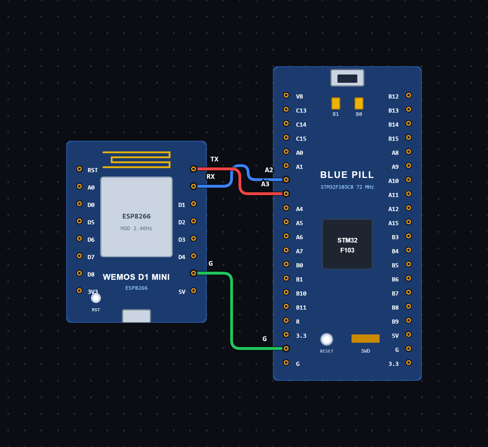

# CAT-11 TASK-11B

| **Field** | **Details** |
|---|---|
| **EXP** | Continuous Lab Evaluation-11 (`CAT11` / `TASK11B`) |
| **TASK NO** | **Task 11B — Dynamic HTTP Webpage & Node-RED Integration** |
| **DATE** | 22/10/2026 |
| **NAME OF EXP** | HTTP Server - STM32–Wemos Wi-Fi Modem Using AT Commands |

## HARDWARE SETUP / PLATFORM

- **Development Board:** STM32 Blue Pill (`STM32F103C8T6`, 72 MHz).
- **Toolchain / IDE:** STM32CubeMX + Keil MDK-ARM.
- **Firmware Libraries:** STM32F1xx HAL Drivers, CMSIS.
- **Peripherals:** Wemos D1 Mini (ESP8266).
- **Pin Mapping:**
  - `PA2` (`USART2_TX`) — Connected to Wemos RX.
  - `PA3` (`USART2_RX`) — Connected to Wemos TX.
  - `GND` — Common ground.

### Hardware Schematic

## CORE LOGIC / PSEUDOCODE / CODE BASE

### Working Principle

- Initializes UART communication and configures the ESP8266 as a TCP server on port 80.
- Detects incoming HTTP requests through `+IPD` notifications.
- Generates a random captured value and constructs an HTML response.
- Uses `AT+CIPSEND` to transmit the HTTP response and `AT+CIPCLOSE` to close the connection.

### Pseudocode

- Initialize HAL, system clock, GPIO and USART2.
- Configure ESP8266 Wi-Fi and start TCP server.
- Receive incoming UART data and search for `+IPD`.
- Extract the connection ID and generate a random value.
- Construct an HTTP response containing HTML content.
- Send the response using `AT+CIPSEND`.
- Close the client connection using `AT+CIPCLOSE`.

### Code Base

- `SystemClock_Config()` – Configures 72 MHz system clock.
- `MX_USART2_UART_Init()` – Initializes UART communication.
- `ESP_Init()` – Configures ESP8266 using AT commands.
- `HAL_UART_Receive()` – Receives incoming network data.
- `sprintf()` – Constructs the HTML page and HTTP response.
- `HAL_UART_Transmit()` – Sends HTTP response through ESP8266.
- `strstr()` – Detects incoming `+IPD` notifications.

## INFERENCE

- Established HTTP communication between a browser and STM32 through the ESP8266 TCP server.
- Successfully generated and transmitted dynamic HTML responses containing randomly generated data using UART AT commands.
