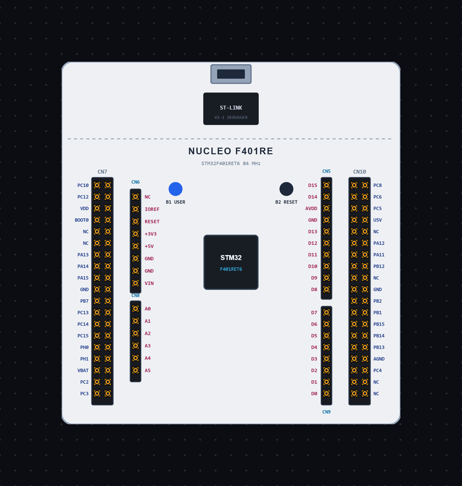

# CAT-12 TASK-12B

| **Field** | **Details** |
|---|---|
| **EXP** | Continuous Lab Evaluation-12 (`CAT12` / `TASK12B`) |
| **TASK NO** | **Task 12B — User Push-Button Controlled LED** |
| **DATE** | 15/10/2026 |
| **NAME OF EXP** | STM32F401RE Cortex-M4: GPIO and User Input Programming |

## HARDWARE SETUP / PLATFORM

- **Development Board:** STM32 Nucleo-F401RE (`STM32F401RET6`, 84 MHz).
- **Toolchain / IDE:** STM32CubeMX + Keil MDK-ARM.
- **Firmware Libraries:** STM32F4 HAL Drivers, CMSIS.
- **Peripherals:** On-board User LED (LD2) and User Push Button (B1).
- **Pin Mapping:**
  - `PA5` – On-board LED (LD2).
  - `PC13` – User Push Button (B1).

### Hardware Schematic

## CORE LOGIC / PSEUDOCODE / CODE BASE

### Working Principle

- Configures PA5 as output and PC13 as input.
- Detects button presses with a 10 ms debounce delay.
- Toggles the LED state once per valid button press.
- Waits for button release before detecting the next press.

### Pseudocode

- Initialize HAL, system clock and GPIO.
- Read the push-button state on PC13.
- Apply a 10 ms debounce delay and verify the press.
- Toggle LED on PA5.
- Wait until the button is released.
- Repeat continuously.

### Code Base

- `HAL_Init()` – Initializes HAL.
- `SystemClock_Config()` – Configures the 84 MHz system clock.
- `MX_GPIO_Init()` – Configures PC13 as input and PA5 as output.
- `HAL_GPIO_ReadPin()` – Reads push-button state.
- `HAL_GPIO_TogglePin()` – Toggles LED state.
- `HAL_Delay(10)` – Implements debounce delay.

## INFERENCE

- Successfully interfaced the on-board push button with the LED.
- Implemented debouncing and state remembrance, ensuring one LED toggle per valid button press.
