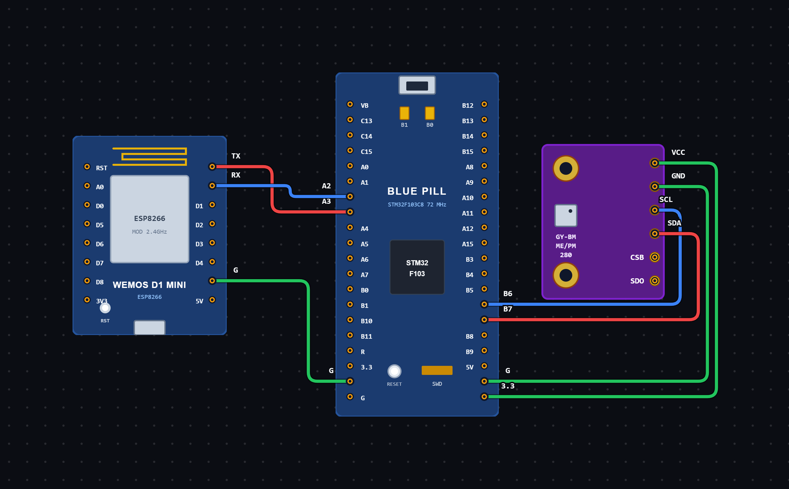

# CAT-13 TASK-13

| **Field** | **Details** |
|---|---|
| **EXP** | Continuous Lab Evaluation-13 (`CAT13`) |
| **TASK NO** | **Task 13 – BME280 Sensor Interfacing** |
| **DATE** | 23/10/2026 |
| **NAME OF EXP** | BME280 Sensor Interfacing Using I2C and Bosch Sensor API |

## HARDWARE SETUP / PLATFORM

- **Development Board:** STM32 Blue Pill (`STM32F103C8T6`, 72 MHz)[cite: 8, 10].
- **Toolchain / IDE:** STM32CubeMX + Keil MDK-ARM[cite: 1].
- **Firmware Libraries:** STM32F1 HAL Drivers, CMSIS, Bosch Sensortec BME280 Sensor API[cite: 1, 8].
- **Peripherals:** `I2C1` (100 kHz, 7-bit addressing)[cite: 8], `USART2` (115200 baud, 8N1)[cite: 8], GY-BME280 Sensor (`0x76`)[cite: 3, 8, 10], and Wemos D1 Mini (ESP8266)[cite: 10].
- **Pin Mapping:**
  - `PB6` – `I2C1_SCL` (Connected to BME280 `SCL`)[cite: 10].
  - `PB7` – `I2C1_SDA` (Connected to BME280 `SDA`)[cite: 10].
  - `3.3V` / `G` – Power and Ground to BME280 `VCC` / `GND`[cite: 10].
  - `PA2` – `USART2_TX` (Connected to Wemos D1 Mini `RX`)[cite: 10].
  - `PA3` – `USART2_RX` (Connected to Wemos D1 Mini `TX`)[cite: 10].
  - `G` – Ground connected to Wemos D1 Mini `G`[cite: 10].

### Hardware Schematic

## CORE LOGIC / PSEUDOCODE / CODE BASE

### Working Principle

- Configures `I2C1` on `PB6`/`PB7` and `USART2` on `PA2`/`PA3` in `main.c`[cite: 8, 10].
- Binds the Bosch BME280 API function pointers (`read`, `write`, `delay_us`) to custom STM32 HAL wrapper functions (`user_i2c_read`, `user_i2c_write`, `user_delay_us`)[cite: 8].
- Initializes the BME280 at primary I2C address `0x76`[cite: 8], configures `1X` oversampling for temperature, pressure, and humidity with filtering disabled[cite: 8], and sets normal power mode[cite: 8].
- Continuously reads compensated environmental data in the `while(1)` loop and converts pressure from $\text{Pa}$ to $\text{hPa}$[cite: 8].

### Pseudocode

- Initialize HAL, 72 MHz system clock, GPIO, `I2C1`, and `USART2`[cite: 8].
- Configure `bme280_dev` structure with slave address `0x76`, I2C interface mode, and custom read/write/delay callbacks[cite: 8].
- Initialize the BME280 sensor using `bme280_init(&dev)`[cite: 8].
- Set `1X` oversampling (`osr_h`, `osr_p`, `osr_t`) and disable IIR filter (`BME280_FILTER_COEFF_OFF`)[cite: 8].
- Set sensor power mode to `BME280_POWERMODE_NORMAL`[cite: 8].
- Read compensated sensor values (`temperature`, `pressure`, `humidity`) continuously inside `while(1)`[cite: 8].

### Code Base

- `HAL_Init()` – Initializes HAL[cite: 8].
- `SystemClock_Config()` – Configures the 72 MHz system clock using HSE and PLL[cite: 8].
- `MX_I2C1_Init()` – Configures `I2C1` at 100 kHz with 7-bit addressing[cite: 8].
- `MX_USART2_UART_Init()` – Configures `USART2` at 115200 baud (8N1)[cite: 8].
- `user_i2c_read()` / `user_i2c_write()` – Wraps `HAL_I2C_Mem_Read()` and `HAL_I2C_Mem_Write()` for 8-bit register access over `hi2c1`[cite: 8].
- `user_delay_us()` – Converts microsecond delays into millisecond delays using `HAL_Delay()`[cite: 8].
- `bme280_init()` / `bme280_set_sensor_settings()` / `bme280_set_sensor_mode()` – Initializes the sensor and configures oversampling, filter, and normal power mode in `main.c`[cite: 8].
- `bme280_get_sensor_data()` – Polls and compensates temperature, pressure, and humidity readings into `comp_data`[cite: 8].

## INFERENCE

- Successfully integrated the Bosch Sensortec BME280 API with `main.c` using custom STM32 HAL `I2C1` and delay wrappers[cite: 8].
- Implemented continuous acquisition of compensated temperature ($^\circ\text{C}$), pressure ($\text{hPa}$), and relative humidity ($\%\text{RH}$) from the BME280 at address `0x76`[cite: 8].
- Configured `USART2` (`115200` baud) and wired the Wemos D1 Mini (ESP8266) interface, ready for subsequent HTTP/JSON data transmission[cite: 6, 8, 10].
