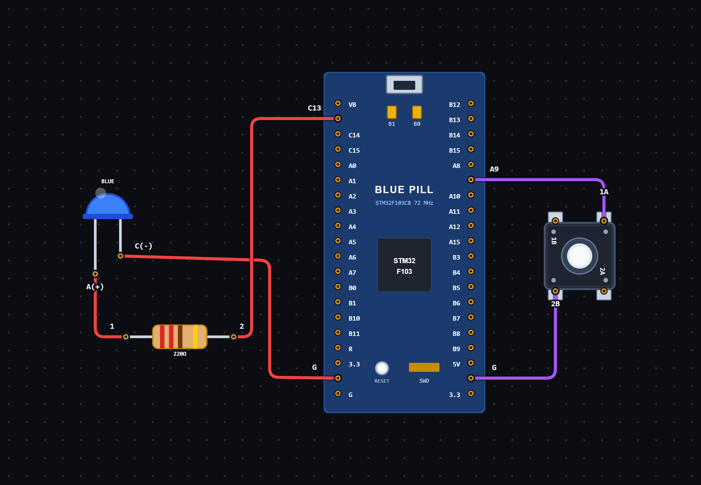

# CAT-8 TASK-8A
| **Field** | **Details** |
|---|---|
| **EXP** | Continuous Lab Evaluation-8 (`CAT8` / `TASK8A`) |
| **TASK NO** | **Task 8A — GPIO Input/Output** |
| **DATE** | 24/09/2026  |
| **NAME OF EXP** | STM32 GPIO Bring-Up and Switch-Controlled LED |

## HARDWARE SETUP / PLATFORM

- **Development Board:** STM32 Blue Pill (`STM32F103C8T6`, ARM Cortex-M3, 72 MHz SYSCLK).
- **Toolchain / IDE:** STM32CubeMX + Keil MDK-ARM.
- **Firmware Libraries:** STM32 HAL Drivers, CMSIS.
- **Peripherals:** Push-button switch and Blue LED with 220 Ω current-limiting resistor.
- **Pin Mapping:**
  - `PA9` — Push-button input (GPIO input with pull-up).
  - `PC13` — LED output (GPIO push-pull).

### Hardware Schematic

## Core Logic / Pseudocode / Code Base

### Working Principle
- GPIO pins `PA9` and `PC13` are configured as input and output respectively.
- The push-button state is continuously monitored using `HAL_GPIO_ReadPin()`.
- When the button is pressed (`GPIO_PIN_RESET`), the LED is turned ON; otherwise, it is turned OFF using `HAL_GPIO_WritePin()`.

### Pseudocode
- Initialize HAL, system clock and GPIO pins.
- Continuously:
  - Read the push-button state at `PA9`.
  - If pressed, set `PC13` LOW.
  - Otherwise, set `PC13` HIGH.
- Repeat indefinitely.

### Code Base

- `main.c` — Implements system clock configuration, GPIO initialization, push-button state detection and LED control using STM32 HAL functions.

## INFERENCE

- Successfully interfaced a push-button and LED with the STM32F103C8T6.
- Demonstrated GPIO input reading and output control using STM32 HAL libraries.
- Implemented switch-controlled LED operation through continuous polling.
