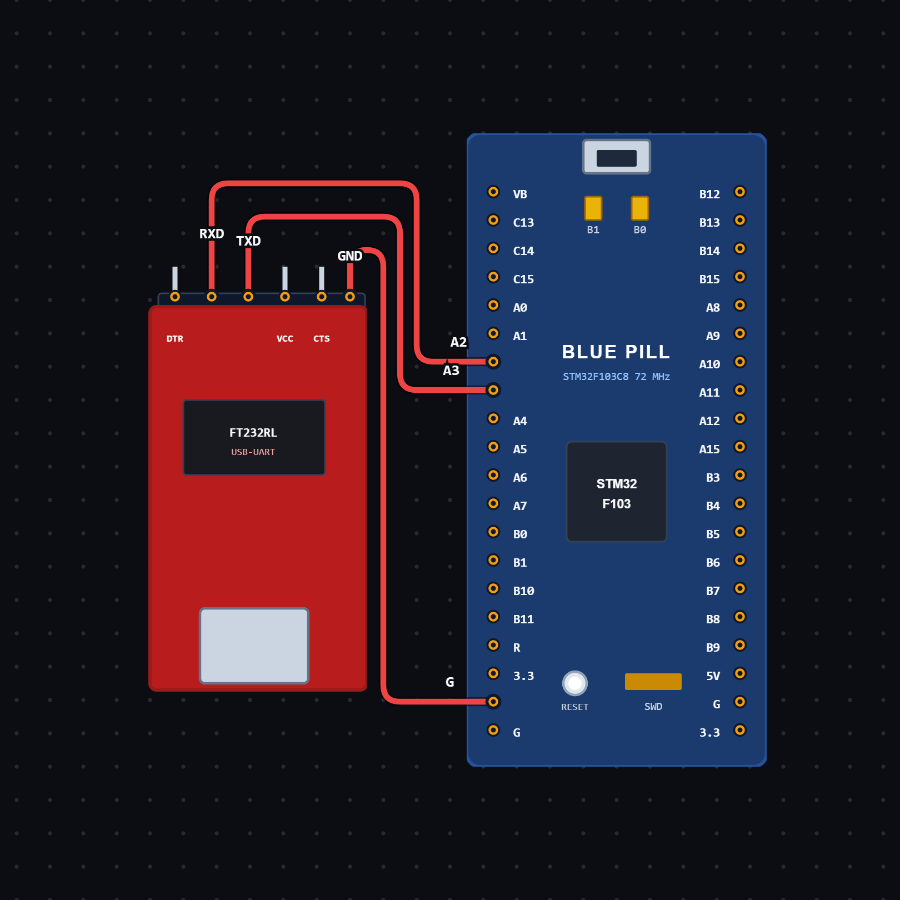

# CAT-9 TASK-9A

| **Field** | **Details** |
|---|---|
| **EXP** | Continuous Lab Evaluation-9 (`CAT9` / `TASK9A`) |
| **TASK NO** | **Task 9A — Basic UART Communication** |
| **DATE** | 01/10/2026 |
| **NAME OF EXP** | STM32 UART Command Controlled LED |
## HARDWARE SETUP / PLATFORM

- **Development Board:** STM32 Blue Pill (`STM32F103C8T6`, ARM Cortex-M3, 72 MHz SYSCLK).
- **Toolchain / IDE:** STM32CubeMX + Keil MDK-ARM.
- **Firmware Libraries:** STM32F1xx HAL Drivers, CMSIS.
- **Peripherals:** FT232RL USB-to-UART Converter and PC Serial Terminal.
- **Pin Mapping:**
  - `PA2` — UART transmit (TX).
  - `PA3` — UART receive (RX).
  - `GND` — Common ground with USB-to-UART converter.

### Hardware Schematic

## Core Logic / Pseudocode / Code Base

### Working Principle
- UART is configured in 8-N-1 mode at 115200 baud.
- `HAL_UART_Receive()` waits for one incoming character from the PC terminal.
- The received character is immediately transmitted back using `HAL_UART_Transmit()`.
- Communication is handled continuously through polling.

### Pseudocode
- Initialize HAL, system clock, GPIO and UART.
- Continuously:
  - Receive one byte through UART.
  - Transmit the received byte back to the PC.
- Repeat indefinitely.

### Code Base

- `main.c` — Configures UART communication, receives individual characters and echoes them back using `HAL_UART_Receive()` and `HAL_UART_Transmit()`.

## INFERENCE

- Established UART communication between STM32 and a PC terminal.
- Demonstrated character reception and echo transmission using STM32 HAL.
- Verified serial communication at 115200 baud.
