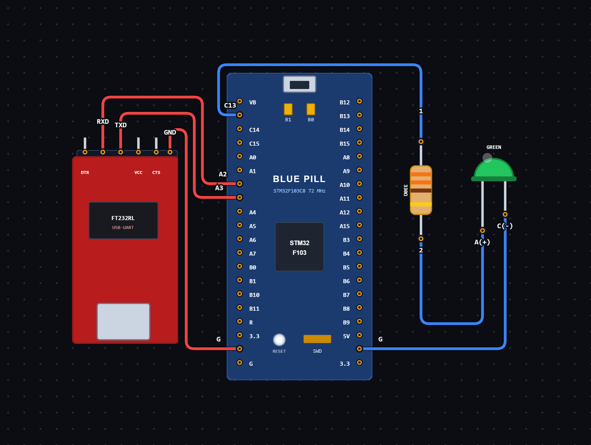

# CAT-9 TASK-9B

| **Field** | **Details** |
|---|---|
| **EXP** | Continuous Lab Evaluation-9 (`CAT9` / `TASK9B`) |
| **TASK NO** | **Task 9B — String-Based Application Logic** |
| **DATE** | 01/10/2026 |
| **NAME OF EXP** | STM32 UART Command Controlled LED |

## HARDWARE SETUP / PLATFORM

- **Development Board:** STM32 Blue Pill (`STM32F103C8T6`, ARM Cortex-M3, 72 MHz).
- **Toolchain / IDE:** STM32CubeMX + Keil MDK-ARM.
- **Firmware Libraries:** STM32F1xx HAL Drivers, CMSIS.
- **Peripherals:** FT232RL USB-to-UART Converter, LED and 330Ω current-limiting resistor.
- **Pin Mapping:**
  - `PA2` — UART connection (FT232RL).
  - `PA3` — UART connection (FT232RL).
  - `PC13` — LED control output.
  - `GND` — Common ground.

### Hardware Schematic

## Core Logic / Pseudocode / Code Base

### Working Principle
- UART is configured at 115200 baud (8-N-1) for serial communication.
- Incoming characters are received and echoed back to the terminal.
- Characters are stored in a buffer until a carriage return or line feed is detected.
- The received command is compared using `strcmp()`:
  - `LED ON` — Turns the LED ON.
  - `LED OFF` — Turns the LED OFF.
  - `LED TOGGLE` — Toggles the LED state.

### Pseudocode
- Initialize HAL, system clock, GPIO and UART.
- Continuously receive and echo characters.
- Store characters until an end-of-line character is received.
- Compare the completed command and control the LED accordingly.
- Send the corresponding confirmation message to the terminal.

### Code Base
- `main.c` — Implements UART command reception, string comparison, LED control using `HAL_GPIO_WritePin()` and `HAL_GPIO_TogglePin()`, and terminal response transmission.

## INFERENCE

- Implemented a UART-based command interface using STM32 HAL.
- Successfully demonstrated string-based command processing and GPIO LED control.
- Established interaction between a PC serial terminal and the STM32 through UART.
